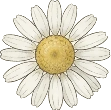
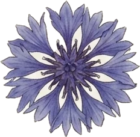
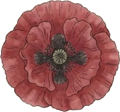
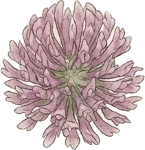

# Визуальные ориентиры для наград и гербария

## Растения из игры

Образцы ниже — штатная графика версии 8. Слева в каждой строке исходная головка; целый экземпляр из тех же деталей можно увидеть с помощью примера ниже. Числа описывают названный орган. Перевод в пиксели, частоты размеров, длительности и палитра являются решениями для игры.

| Исходная деталь | Вид | Измерения и признаки из флоры | Что должно читаться в игре |
|---|---|---|---|
|  | Ромашка (`daisy`) | Корзинка 10–25 мм в диаметре, лист 30–70 мм, сегменты до 0,8 мм в ширину. [Описание вида](https://plantnet.rbgsyd.nsw.gov.au/cgi-bin/NSWfl.pl?lvl=sp&name=Matricaria~chamomilla&page=nswfl) | Во фронтальном виде различимы диск и краевые цветки; тонкая рассечённая листва не превращается в широкую пластинку. |
|  | Василёк (`cornflower`) | Нижний лист 40–50 × 2–5 мм. На концах побегов одиночные корзинки; наружные цветки расходятся в стороны. [Описание вида](https://plantnet.rbgsyd.nsw.gov.au/cgi-bin/NSWfl.pl?lvl=sp&name=Centaurea~cyanus&page=nswfl) | Узкие листья и расширяющийся верх головки. Размах цветков и диаметр её основания измерять отдельно. |
|  | Мак (`poppy`) | В описании VicFlora лепесток до 35 мм; у основания часто бывает тёмное пятно. [Описание вида](https://vicflora.rbg.vic.gov.au/flora/taxon/1d9d59f0-bdbd-4118-9bc0-51785bd44ea4) | Указывать длину одного лепестка. Передавать перекрытие тонких лепестков и вариативность пятна. |
|  | Клевер (`clover`) | Соцветие 20–30 × 20–30 мм, шаровидное или яйцевидное; лист тройчатый. [Описание вида](https://vicflora.rbg.vic.gov.au/flora/taxon/d696e3c0-77b6-4528-b4ed-39fb98e44a1b) | Силуэт держится группой мелких цветков. Вариация размера сохраняет тройчатый лист. |

### Два музейных ориентира

- **Бумага и монтаж.** На рисунке 7 в руководстве Kew видны согнутый побег, отдельная бумажная полоска и этикетка в нижней части листа. Для книги использовать ясное разделение силуэта, места крепления и текста. Рисунки 3–4 показывают, как разные стороны листа и цветка помогают разобрать форму при прессовании. [Kew, Making herbarium specimens, рис. 3, 4, 7](https://brahmsonline.kew.org/Content/Projects/msbp/resources/Training/15-making-herbarium-specimens.pdf)
- **Общий вид страницы.** На странице Smithsonian есть фотография оцифрованного гербарного листа. Сначала оценивать читаемость силуэта целиком, затем детали крепления. Логотипы, штрихкоды и музейные подписи в оформление Bingo Bloom переносить не нужно. [Smithsonian, Digitized!](https://naturalhistory.si.edu/research/botany/news-and-highlights/digitized)

### Сравнить собственные рисунки без поиска ассетов

На локальном сайте из `npm start` запустить пример в консоли браузера. Он добавит закрываемую галерею, не записывая ничего в сохранение. В каждой строке свежий и сухой вид одного экземпляра. Для эталона использовать ревизию `fa9793de`; после изменения генератора повторить с выбранной версией. Для импорта игровых состояний есть [готовые JSON](README.md).

```js
(async () => {
  const {drawSpecimen} = await import('/plants/specimen.js');
  const dialog = document.createElement('dialog');
  const close = document.createElement('button');
  close.textContent = 'Закрыть галерею';
  close.onclick = () => dialog.close();
  dialog.addEventListener('close', () => dialog.remove(), {once: true});
  dialog.append(close);
  document.body.append(dialog);
  dialog.showModal();
  for (const speciesId of ['daisy', 'cornflower', 'poppy', 'clover']) {
    const row = document.createElement('section');
    const label = document.createElement('h3');
    const seed = 'garden-0';
    label.textContent = speciesId + ' · ' + seed + ' · v2';
    row.append(label);
    dialog.append(row);
    for (const state of ['fresh', 'pressed']) {
      const canvas = document.createElement('canvas');
      canvas.width = 250;
      canvas.height = 310;
      canvas.style.width = 'min(35vw, 250px)';
      canvas.setAttribute('aria-label', state);
      row.append(canvas);
      await drawSpecimen(canvas, {speciesId, seed, formVersion: 2, state});
    }
  }
})();
```

## Раскадровка для реализации

| Момент | Что видно | Что может сделать игрок |
|---|---|---|
| Карточка раскрылась | Один направленный блик скользит по рисунку, по краю остаётся немного цвета. Подпись неподвижна. | Сразу читать, закрыть или вернуться к полю. |
| Поле снова открыто | На пересечении A1 подсвечиваются верхняя строка и левый столбец. От каждой линии отделяется её экземпляр. У цели обновлённый счётчик. | Продолжать играть или открыть корзинку по нужному цветку. |
| Нажато «Засушить» | Та же ветвь на светлой бумаге; головка мягко оседает, тень сужается, цвет меняется постепенно. Крепление появляется ближе к концу. | Уйти сразу либо открыть конкретный лист. |
| Лист книги | На бумаге различимы лепестки, места соединений и прикреплённый стебель. Указаны источник и дата. | Полистать экземпляры, сохранить открытку или вернуться к исходному месту. |

Рабочая палитра: фон бумаги `#F2ECDE`, тень корешка `#D9CDB8`, текст `#403A32`, акцент `#657054`. Для новой формы зафиксировать три кадра при доле прессования 0, 0,5 и 1. В координатах исходника 250×310 проверить прикрепление листа и головки на прозрачном фоне и на бумаге, в том числе в зеркальной позе. Контрольные размеры текущей игры — миниатюра 150×186, большой рисунок 650×806 и открытка шириной 900 px. Сравнивать сам рисунок на одинаковом холсте; вся открытка включает также подписи и поля.
